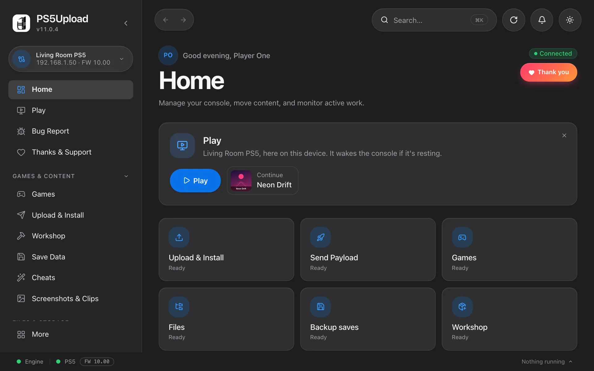
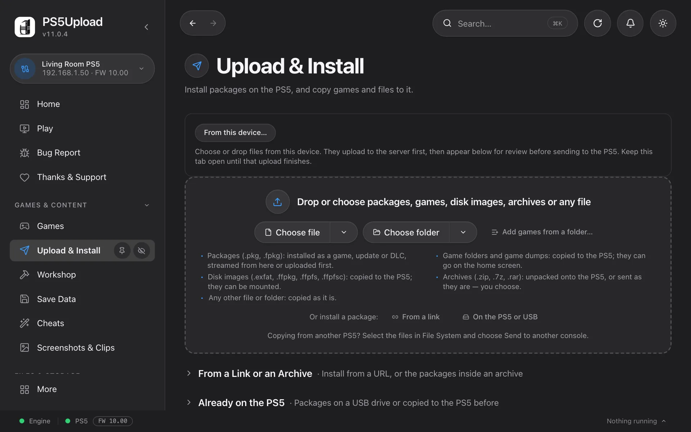
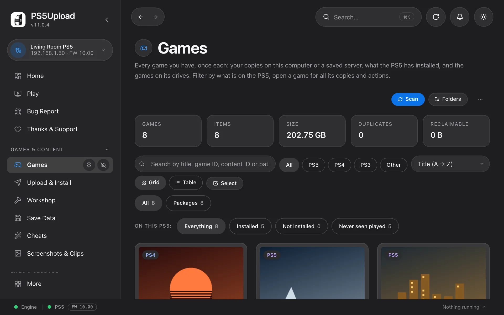
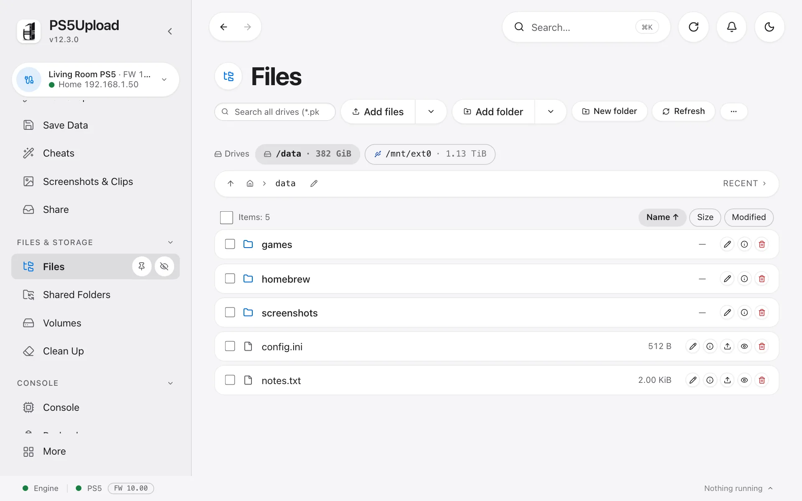
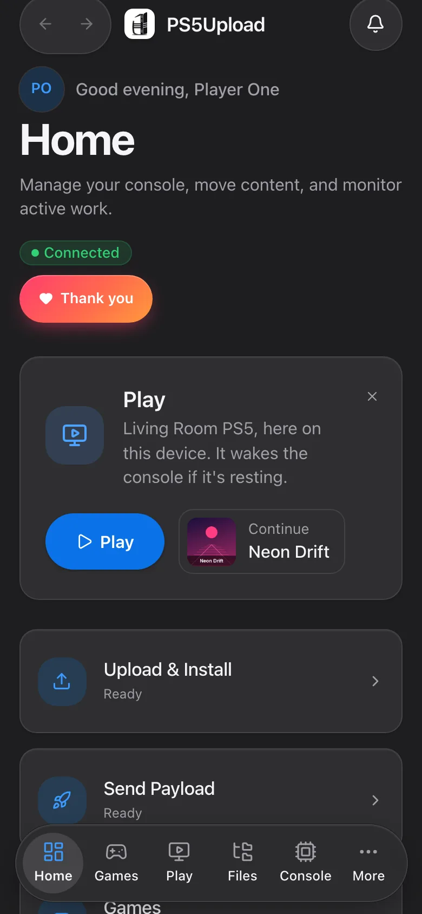

# PS5Upload NAS

**A browser-based PS5 companion for your NAS, with the PS5-LZ4-NAS tools integrated and new conversions restricted to Zstd.**

Upload and install packages, browse your console, manage your game collection and convert unpacked games to verified Zstd copies from one web interface. Based on [PS5Upload](https://github.com/phantomptr/ps5upload) and [PS5-LZ4-NAS](https://github.com/dviree/PS5-LZ4-NAS).

[Features](#features) · [Screenshots](#screenshots) · [Install](#install-on-your-nas) · [Update](#update) · [Source and credits](#source-and-credits)



*Home screen. The screenshots on this page are bundled PS5Upload upstream previews with example data; they show the shared interface. This fork adds the Zstd NAS converter under Convert Games. They are not screenshots of a live user's NAS or proof of console compatibility.*

## Features

| Area | What you can do |
| --- | --- |
| Upload & Install | Send games, folders, archives and packages; resume interrupted transfers and follow the queue. |
| Zstd conversion | Convert original game folders, PS5 game PKGs or supported images with PS5 Dump Forge, verify the output and keep the original. |
| Files and Collection | Browse mounted folders and include existing Zstd games automatically when `/zstd` is mounted. |
| Packages | Browse packages by game, including base, update and DLC; install individual packages or the remaining set. |
| Console tools | Browse files, manage saves, use cheats, send payloads and use the upstream Remote Play tools. |
| NAS tools | Use the integrated converter's library, transfer queue, exFAT image tools and ShadowMountPlus actions. |

### Zstd is the conversion format

New packing jobs use **Zstd with ampr-emu-ng**, at **level 5 by default** (levels 1–22). LZ4 packing is disabled in the interface, API and CLI. Existing packed files can still be inspected or decoded. Existing games are not automatically converted, deleted or overwritten.

The NAS converter uses **PS5 Dump Forge 0.5.5** and **ampr-emu-ng 0.4.0**, pinned to commit [`920e917`](https://github.com/quer3q/ampr-emu-ng/commit/920e9172b6bf99bd9210361b545e2953659d1e9b). This includes PKG mode, writable `/app0` and split reads, alongside earlier packed-read fixes. The converter can prepare and submit game reports with the detected title ID and version. Build and host verification do not guarantee that every game works on a console.

For packed games, use ShadowMountPlus and turn off its fakelib updates so it retains the runtime installed with the converted game.

## Screenshots

### Upload and install



### Browse your collection



### Files



### On a phone

<p align="center">
  
</p>

*These upstream previews show the shared PS5Upload screens, not the added Zstd converter. Appearance and available actions depend on the build, viewport and console state.*

## Install on your NAS

Use the combined image:

```text
ghcr.io/dviree/ps5upload-engine-webui:latest
```

The legacy `:lz4` image tag remains an alias for existing installations; it does **not** enable LZ4 conversion.

1. Clone this repository and open [`engine/compose.yaml`](engine/compose.yaml).
2. Set your console address, trusted LAN range and host folder mounts in that file.
3. Set `PS5UPLOAD_ZSTD_PATH` to your existing output folder, then start the container:

```sh
git clone https://github.com/dviree/ps5uploadNAS.git
cd ps5uploadNAS
export PS5UPLOAD_ZSTD_PATH=/srv/ps5/zstd
docker compose -f engine/compose.yaml up -d
```

Open **`http://<NAS-IP>:19113`** from an allowed device. The converter is available through **Convert Games → Zstd**, using the same engine address and IP allowlist.

| Container path | Purpose | Access |
| --- | --- | --- |
| `/ps5` | Original games and supported source images | Read-only |
| `/zstd` | Converted Zstd output and existing packed games | Read/write |
| `/pkgs` | Packages to install | Read-only |
| `/data` | App settings, history and converter state | Persistent read/write |

Keep the `/data` volume between updates. Converter state lives in `/data/ps5lz4`; use a separate state folder for any standalone worker. Mounted Zstd output is added to Files and Collection while preserving saved folders and preferences. `PS5UPLOAD_COLLECTION_ROOTS` can add other existing local library folders.

The engine has no login screen: its IP allowlist determines access. Allow only trusted devices; keep port 19113 on your LAN. Source and output mounts must be separate.

## Update

Once the [Docker build](https://github.com/dviree/ps5uploadNAS/actions/workflows/docker-engine.yml) is green:

```sh
docker compose -f engine/compose.yaml pull
docker compose -f engine/compose.yaml up -d
```

Keep the same mounts and `PS5UPLOAD_ZSTD_PATH` when recreating the container. If you already use a custom NAS update script, continue to use that script.

For older `docker run` installations missing the Zstd mount, this helper can add it to the existing updater:

```sh
python3 scripts/configure-zstd-folder.py /path/to/ps5upload-update.sh /path/to/games/ps5zstd
```

It backs up the updater as `.before-zstd`, preserves its other options and refuses to replace a conflicting `/zstd` mount. Run your usual updater afterwards.

## Source and credits

- **PS5Upload:** upstream application, engine and console helper by [phantomptr](https://github.com/phantomptr/ps5upload). See the [upstream user guide](UPSTREAM_README.md), [FAQ](FAQ.md) and [changelog](CHANGELOG.md). Native app releases linked there are upstream builds; this fork publishes Docker images.
- **PS5-LZ4-NAS:** the complete source tree is included under [`vendor/ps5-lz4-nas`](vendor/ps5-lz4-nas): NAS application, standalone installer/update scripts, Glass receiver sources, tests, update tools, documentation and licenses. See [import provenance and local changes](vendor/ps5-lz4-nas/UPSTREAM.md).
- **PS5 Dump Forge / ampr-emu-ng:** by [quer3q](https://github.com/quer3q), with contributions including fixes by James St-Pierre. The Docker build pins the runtime source, runs its tests and verification, and includes its license and corresponding source archive.
- **Glass receiver:** based on [Loopayeh/pkg-sender](https://github.com/Loopayeh/pkg-sender). Full overlay source and its original build recipe are included; the app fetches the existing receiver release on demand. No payload is installed on a console just by updating the NAS image.

Only the Docker build runs automatically in this fork. Imported workflow files inside the vendor directory are reference source, not active repository workflows.

[License](LICENSE) · [Third-party notices](vendor/ps5-lz4-nas/THIRD_PARTY_NOTICES.md)
