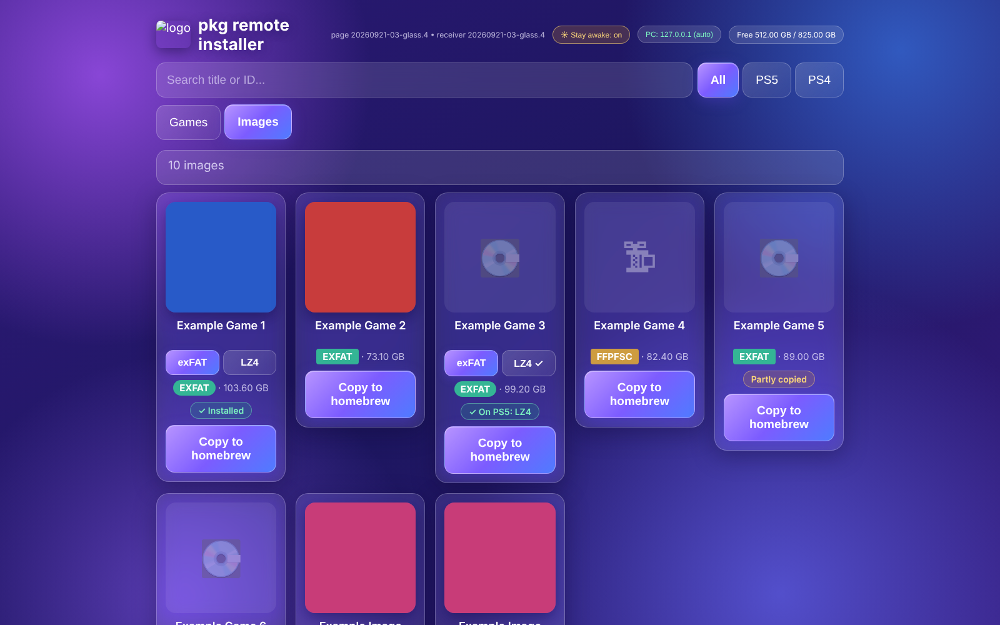

# PS5-LZ4-NAS

A **PS5 and PS4 game manager that runs on your NAS**: pack PS5 games with
**LZ4 HC for APR-EMU**, check them byte for byte, send them to the console,
install `.pkg` games, back up saves and manage what ShadowMountPlus shows,
all from one web page. Nothing runs on the PS5 but the game and one small
payload. A fork of
[theghostonline/PS5-LZ4-Compression](https://github.com/theghostonline/PS5-LZ4-Compression),
kept in sync with it.

Full guide: [nas-lz4/README.md](../nas-lz4/README.md).


## What it does

**On the NAS**
- **LZ4 HC packs** (`AMPRPAK4` / `AMPRDAT3`) built with the original
  project's packer, level 9 by default, plus the pinned **APR-EMU
  PackedStdio 0.4.2.1** runtime in `fakelib/libSceAmpr.sprx`.
- **Sources:** game folders, `.exfat`, `.ffpfs` and `.ffpfsc` images, and
  **RAR archives**: extracted (CRC of every file checked) into a checked
  `.exfat`; the RAR files go only on request, after the image is checked
  against the archive again.
- **Checks before anything is published:** every chunk decoded and compared
  with the original, then a full unpack compared byte for byte. **Verify
  LZ4** re-checks a copy before sending; **Check all** / **Repair** check
  every game. Games that don't use AMPR are skipped with the reason.
- **exFAT images** of LZ4 copies, built and compared file by file.
- **Originals are never changed** unless you turn that on
  (`DELETE_ORIGINALS=yes`); the library is mounted read-only.

**To the PS5**
- **Send to PS5** over FTP (ftpsrv), resumable and queued: every file's size
  checked, program files by SHA-256, large files spot-checked, and a final
  listing proves nothing was dropped. A free-space check refuses what can't
  fit. **Verify** compares a game on the PS5 with the NAS later.
- **PS4 and PS5 `.pkg`** (name, version, game / patch / DLC, cover) installed
  by the console itself, downloaded straight from the NAS, with live progress
  and Retry.
- **PS5 games tab:** every game on every drive and the installed PS4 games,
  with **Needs attention** (what ShadowMountPlus won't pick up, with Fix),
  Verify, Delete (also takes the tile off the home screen) and Uninstall.
- **ShadowMount tab:** the games ShadowMountPlus shows, from its own API:
  remove from the home screen, hide, unmount, rescan, its logs.
- **Saves tab:** back up every PS5/PS4 save to the NAS, download as .zip,
  restore one game.
- **Wake from rest mode** (Remote Play pairing, like Chiaki), keep the PS5
  awake during work, and notifications on the PS5 and your phone (ntfy or a
  webhook).

**On the PS5:** the *pkg remote installer* page of
[pkg-receiver](https://github.com/Loopayeh/pkg-sender), rebuilt here with a
Glass theme and extras (installed / on-PS5 marks, LZ4 or exFAT per game,
keep-awake, ShadowMountPlus bridge): see [pkg-receiver/](../pkg-receiver/).



**Also:** the original project's community game reports and the `.ffpfsc`
compatibility sheet per title, a Store page for the PS5 browser, Glass /
Light / Dark themes, Prometheus `/metrics`, an FPKGi feed.

## Install

On the NAS, as root:

```sh
mkdir -p /volume2/docker/ps5-lz4 && cd /volume2/docker/ps5-lz4
curl -fL https://github.com/dviree/PS5-LZ4-NAS/archive/refs/heads/main.tar.gz | tar xz
mv PS5-LZ4-NAS-main src
bash src/nas-lz4/install.sh --check      # look only
nohup bash src/nas-lz4/install.sh > install.log 2>&1
```

Paths, user and options are environment variables (`LIBRARY`, `OUTPUT`,
`PS4_LIBRARY`, `BASE`, `NAS_USER`, `UI_PORT`, `DELETE_ORIGINALS`); see the
guide. Then open `http://<NAS IP>:5921` and press **Start ELF on PS5**.
Updates: `./lz4-ps5.sh update` (the image `ghcr.io/dviree/ps5-lz4:latest`
is rebuilt after every change).

## Layout

| Path | What |
| --- | --- |
| `nas-lz4/` | The NAS tool: `ps5lz4.py` (CLI, web page, agent, FTP), `ui.html`, `store.html`, `install.sh`, Dockerfile |
| `pkg-receiver/` | Glass theme and extras for pkg-receiver (built by `pkg-receiver.yml`, release `pkg-receiver-glass`) |
| `nas-lz4/ps5regist.py` | Remote Play pairing, ported from chiaki-ng (AGPL-3.0) |
| `nas/` | The original engine's web app built for Linux (port 5920) |
| `src/`, `app/`, `tests/` | The original project (PS5 app and packer) |

## Credits

- [theghostonline/PS5-LZ4-Compression](https://github.com/theghostonline/PS5-LZ4-Compression):
  the packer, profiles and community reports (GPL-3.0).
- [Loopayeh/pkg-sender](https://github.com/Loopayeh/pkg-sender) (MIT):
  pkg-receiver; ideas from
  [pkg-sender-synology](https://github.com/mrggbond/pkg-sender-synology) (MIT).
- [drakmor/ampr_emu](https://github.com/drakmor/ampr_emu) (APR-EMU) and
  [drakmor/ShadowMountPlus](https://github.com/drakmor/ShadowMountPlus).
- [streetpea/chiaki-ng](https://github.com/streetpea/chiaki-ng): Remote Play
  discovery, wake-up and registration (AGPL-3.0).
- Ideas from game-library-manager-ps5, ps5upload, P5 Manager, ps5-exporter
  and FPKGi (reimplemented, no code copied).
- [MkPFS](https://pypi.org/project/mkpfs/) for exFAT and PFS images,
  [ps5-payload-dev/ftpsrv](https://github.com/ps5-payload-dev/ftpsrv) on the
  console, UnRAR (RARLAB freeware) for archives.

Use it with games you own. Verified on the NAS is not the same as tested on
the PS5: mark the result per game on the web page and share it with the
community.
