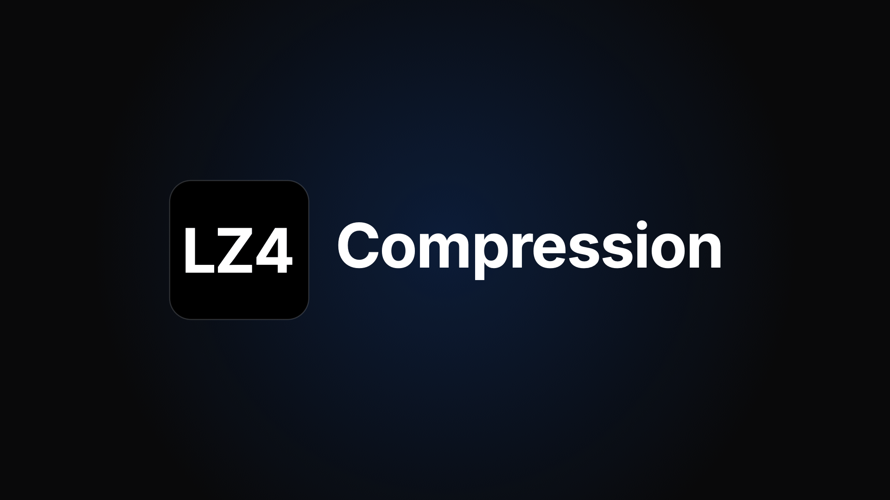

# LZ4 Compression for PS5

[](https://buymeacoffee.com/theghostonline)



LZ4 compression for PS5 games, done entirely on the console. Pick a game,
choose `Compress with LZ4`, and it packs the game data into seekable LZ4 asset
packs that APR-EMU reads while the game runs, checks every file, and installs
the pack-capable APR-EMU runtime (adding it when the game ships none). The game
never has to leave the console.

It also does everything around that: `.ffpfsc` compression, exFAT/PFS images,
validate and repair, APR-EMU versions, copy and move, and a history of every
job.

Unofficial, and not affiliated with any of the projects it builds on. See
[Credits and license](#credits-and-license).

## The app

- **The PS5 app** (`LZ4 Compression`, title `PPSA99420`): a native app, no
  browser. Your library runs left to right like the home screen, every game
  opens its own page, and every action opens as a full page. D-pad and stick
  navigation with controller vibration, and Circle goes back.
- **The engine** (`lz4-compression.elf`): the payload that does the work. It
  serves the app and the web page on port `5920` and keeps its settings,
  caches and logs in `/data/LZ4Compression`. The app starts it through
  Payload Manager when it isn't running.
- **The web page** at `http://<PS5 IP>:5920` has the same features from a PC
  or phone, and it's where you upload TOML profiles from another device.
- It doesn't share a tile, port or settings folder with Game Compressor, so
  both can be installed.

## Install

1. Download `lz4-compression.elf` and `LZ4-Compression-PPSA99420.zip` from
   the [latest release](https://github.com/theghostonline/PS5-LZ4-Compression/releases/latest).
2. Add `lz4-compression.elf` to Payload Manager, so it sits at
   `/data/pldmgr/payloads/lz4-compression/lz4-compression.elf`. The app starts
   it from there.
3. Unzip the app and copy the `PPSA99420` folder to `/data/homebrew/PPSA99420`
   over FTP. ShadowMount+ adds the `LZ4 Compression` tile. It doesn't scan
   while a game is running, so close any game if the tile doesn't show up.
4. Open the tile. If the engine isn't running, the app starts it.

You can also skip the app: load the ELF and open `http://<PS5 IP>:5920` in
any browser.

### Run it on a NAS instead

The engine also runs entirely on a NAS (Docker on Synology, QNAP, Unraid,
TrueNAS or any Linux box), with nothing installed on the PS5: you open the
same web page at `http://<NAS IP>:5920` and it works on the games stored on
the NAS. See [nas/README.md](nas/README.md).

## LZ4 asset packs

APR-EMU (drakmor's [ampr_emu](https://github.com/drakmor/ampr_emu)) can read
game data from seekable LZ4 asset packs while the game runs. LZ4 Compression
builds those packs for you:

1. Builds `ampr_emu.index` for the complete game.
2. Picks what to pack. The automatic profile scans the game: game data is
   packed, while executables, PRX/SPRX, `sce_sys`, `sce_module`, `fakelib`,
   saves, configs and already-compressed media stay loose. Large files that
   LZ4 can't shrink are sampled and left loose automatically.
3. Compresses every block with LZ4 at the level you pick (1 to 12) on all CPU cores.
4. Writes `ampr_assets.index`, its `.crc` and `.runtime` sidecars and the
   `ampr_assets-*.pak` volumes (AMPRPAK4 / AMPRDAT3, the same format
   `ampr_pack.py` writes).
5. Checks every packed file byte for byte against the original before
   anything is deleted.
6. Installs the pack-capable APR-EMU runtime (0.4.2.1 PackedStdio) into
   `fakelib/libSceAmpr.sprx`.

### How to use it

LZ4 is the main action for every game that uses AMPR, which is most PS5
games, whether or not the dump ships APR-EMU. The app checks the game's
`eboot.bin` and `sce_module` for the `libSceAmpr` import. When the game has no
`fakelib/libSceAmpr.sprx`, packing adds the pack-capable APR-EMU runtime
there, and ShadowMount+ loads it in place of the system module when the game
starts. A game that never imports AMPR can't load APR-EMU, so it gets
`.ffpfsc` compression instead. Folder games work directly; `.exfat`, `.ffpfs`
and `.ffpfsc` images are mounted through ShadowMount+ for the job (close any
running game first, ShadowMount+ won't mount while one is open).

Open the game from the library: `Compress with LZ4` is its main button.
`.ffpfsc` Compress is under Options.

- **Compression level:** the same 1 to 12 scale as Lazy_AMPR. 1 to 4 use
  LZ4's fast mode, 5 to 12 use LZ4 HC. 9 is the default, 12 is the smallest
  and slowest.
- **Packing profile:** `Automatic` picks the best profile on its own. The
  app ships the tested community profiles from [`profiles/`](profiles/)
  (ASTRO BOT, EA Sports UFC 6, and the Insomniac and Unity engine profiles)
  and matches them by Title ID, by name, or by the game's file layout, so a
  matching game already has the right TOML when you open it. The game page
  shows which one it will use. Games without a match get the scan-based
  profile, and `Scan only` skips the bundled one.
- `Custom or Trace Config` uses your own
  `ampr_pack` TOML, for example one generated from APR traces with
  `ampr_pack_profile.py` or a community profile for the game. Two ways to get
  one in:
  - **Import config** in the PS5 app (or Import From Console on the web page)
    lists the `.toml` files in `/data/LZ4Compression/import` and on any USB
    drive (top folder, `toml`, `tomls`, `toml_profiles`, `profiles`,
    `LZ4Compression` or `Lazy_AMPR`). Files named after the Title ID or the
    game's name show up first, the same matching Lazy_AMPR uses.
    `include_from` lists next to the TOML are copied with it.
  - Upload `profile.toml` plus any `include_from` lists it names from a PC
    or phone browser.

  Your own config always wins over the bundled one. Profiles are stored in
  `/data/LZ4Compression/lz4-profiles/<TITLE_ID>/`, and the scan-based
  profile also learns the loose rules from every bundled and uploaded
  profile.
- **Destination:** next to the game, internal SSD or external storage. The
  output is a game folder named `<name>-lz4`.
- **Original handling:**
  - `Keep original` leaves the source alone.
  - `Delete after verified` removes it after the packs and every copied file
    were checked.
  - `Pack in place` (folders only) writes the packs inside the game folder,
    verifies them, then removes only the originals that are now inside the
    packs. It needs the least free space. If anything fails before the
    removal step, the folder, its `ampr_emu.index` and its APR-EMU file are
    put back exactly as they were.

LZ4 packed games show an `LZ4 Packed` chip, and their main action becomes
`Verify LZ4 Packs`, which decodes every block and checks it against the CRC
sidecar. `Uncompress LZ4` restores the loose game, either in place or as a new
folder.

While a game is LZ4 packed, `Build AMPR Index`, `Choose APR-EMU Version` and
`Restore Original APR-EMU` are blocked: the packs are tied to that exact
`ampr_emu.index`, and only the PackedStdio runtime can read them. The original
APR-EMU file is backed up first, so `Restore Original APR-EMU` is offered
again once you uncompress that folder in place. Compress to `.ffpfsc` and Make Image still work on a
packed folder and keep its index untouched.

### How it was checked

- The C packer was compared with drakmor's `ampr_pack.py` driven by
  Lazy_AMPR's own profile generator on the same files. File records, chunk
  records, pack volumes and CRC sidecars are byte-identical at LZ4 HC 9 and
  HC 12, with the automatic profile, a custom profile (streaming, striping,
  `store`, hash and round-robin lanes, group dedupe, volume rollover,
  `include_from`) and with learned loose patterns. Only the build ID differs.
  LZ4 fast output matches the official LZ4 1.10.0 library (`ampr_pack.py`
  with python-lz4 uses LZ4 1.9.4, which compresses fast mode differently).
- `ampr_pack.py verify --root`, `inspect` and `unpack` accept the packs built
  on the PS5.
- On a PS5 running firmware 13.60, packing, verifying, unpacking and in-place
  round trips through the app gave byte-identical results, on both
  internal storage and an exFAT M.2 drive.
- Packing straight from a ShadowMountPlus-mounted `.exfat` image on the PS5
  passed `ampr_pack.py verify --root` against the original files, and
  unpacking those packs gave back every file byte for byte. `.ffpfsc` sources
  use the same code path but haven't been tested on a console yet.

Results vary by game, and a trace-based profile is more reliable than the
automatic one. Keep a backup and launch the
game before you delete its original.

## Firmware 13.60 and ShadowMountPlus 1.7

Works with the current mount stack, so `Validate`, `Validate and Repair` and
`Update APR-EMU` work on current consoles:

- **Built with ps5-payload-sdk v0.43**, whose CRT supports firmware 13.60.
- **Accepts ShadowMountPlus 1.7's layered `mount_img.lnk` format.** SMP 1.7
  writes the link to the *outer* container (`layers=2`, e.g.
  `/data/homebrew/GAME.ffpfsc`) instead of the 1.6-style nested path
  (`/mnt/shadowmnt/pfsc/<name>/GAME.exfat`). The remount verification now
  derives the expected nested directory from the actual link and accepts the
  layered form, so compressed `.ffpfsc` titles pass the mount gate again.
- **Accepts folder titles exposed as real files on `/system_ex`** (firmware
  13.60 behavior with kstuff 1.11), not only `nullfs` overlays, in the
  `system_ex` binding check used by `Update APR-EMU` and mount verification.
- **Self-healing mounts:** SMP keeps its LVD image mounts across
  restarts while LZ4 Compression clears mount links at the start of
  mount-dependent operations, which could previously leave both sides waiting
  on each other. While waiting for a remount, LZ4 Compression now asks SMP's
  local API to mount the title (`POST 127.0.0.1:10101/api/v1/games/mount`)
  after 5 s and every 15 s afterwards, so `Validate`, `Validate and Repair`,
  and compress finalize recover on their own. The nudge is a best-effort
  hint: if SMP's API is disabled the wait falls back to the previous
  scan/restart behavior.

Tested on PS5 firmware **13.60** with **kstuff-lite 1.11** and
**ShadowMountPlus 1.7beta3/1.7beta4**: a 67 GB title compressed to `.ffpfsc`
(19.5 GB) and its full hash validation (1,029,215 blocks) completed clean,
with the title mounted and launchable afterwards.

## Rest mode and interrupted jobs

During ordinary copying, compression, unpacking, scanning, and validation,
LZ4 Compression allows automatic rest mode. If the PS5 preserves the payload
process, the worker continues after wake and the web UI refreshes its progress
and history when reopened. During source deletion, destructive stream
compression, block repair, and mount/configuration changes, LZ4 Compression
renews the console's automatic rest timer until the critical phase ends.

The power timer cannot prevent someone from choosing rest mode manually.
Avoid manual rest while an operation is changing existing game data. If the
payload stops during rest or restarts afterward, unfinished jobs are recorded
as interrupted in history. Queued jobs are cancelled, and running jobs are
marked failed; neither is restarted automatically. Inspect the source and
output paths before retrying, especially after destructive compression or
deletion.

## Main Features

- Compress mounted game folders or images into FF-PFSC output.
- Choose PFS or exFAT output when compressing.
- Automatically build APR Emu `ampr_emu.index` before compressing APR titles.
- Manually run `Build AMPR Index` on a folder when you only want to refresh the
  APR index.
- Compress games into seekable LZ4 asset packs on the PS5, verify
  them, and uncompress them again (see above).
- Validate compressed games and repair detected PFSC block issues when possible.
- Uncompress compressed games back to folder/app form.
- Move supported titles between internal storage and USB storage.
- Track progress, speed, estimated remaining time, and operation history.
- Keep operations running on the PS5 even if the app or the browser tab
  closes.

## APR Emu Support

APR Emu titles need an `ampr_emu.index` file and the correct ShadowMountPlus
read-only image settings when they are run from internal SSD. LZ4 Compression
handles those details for the common workflows:

- To compress a folder-format APR Emu game from USB and run it from internal
  SSD, plug in the USB drive, select the title, and choose `Compress`. The
  app builds `ampr_emu.index` using the same workflow as
  `build_ampr_index.py`, writes the ShadowMountPlus read-only and sector-size
  settings, creates the `.ffpfsc` image, mounts it, and validates the mounted
  image byte-for-byte against the original.
- If the compressed game stutters and you still want it on internal SSD, open
  the game page and choose `Uncompress` under Options, then select `exFAT`. The
  ShadowMountPlus settings and `ampr_emu.index` are already in place, so the
  app leaves them unchanged and creates an uncompressed exFAT image.
- If you already know the game should stay uncompressed, choose `Make Image`
  under Options, then select `exFAT` and `Internal SSD`.
  LZ4 Compression detects the APR Emu title, builds or refreshes
  `ampr_emu.index`, applies the read-only ShadowMountPlus settings, and creates
  the uncompressed image.
- If you already have an exFAT image and `ampr_emu.index` exists, use `Set Read
  Only` under Options to apply the ShadowMountPlus read-only
  settings for that image.

The only unsupported automatic case is an existing exFAT image with no
`ampr_emu.index`. For that case, run the game once from external USB without
read-only settings so APR Emu can create its index, confirm the game starts,
then copy it to internal SSD and use `Set Read Only`.

Non-APR titles keep the normal compression path. When APR indexing is performed,
the selected game screen and operation history show `APR indexed`.

The in-app `APR-EMU Version` picker uses Pippo's public APR-EMU manifest and
binary mirror:

```text
https://pippo26442999.github.io/.exFAT/ampr-emu-drakmor/manifest.json
```

The manifest and hosted files are provided by Pippo (`pippo26442999`). Manifest
entries are downloaded by the browser, uploaded to LZ4 Compression, cached under
`/data/LZ4Compression/ampr-emu`, and then applied to the selected title or
image. Custom `.sprx`/`.prx` files can also be uploaded manually from a desktop
browser. The upstream APR Emu project source is
[drakmor/ampr_emu](https://github.com/drakmor/ampr_emu).

## Requirements

- A PS5 homebrew environment capable of running payload ELFs.
- [ShadowMountPlus](https://github.com/drakmor/ShadowMountPlus) latest version,
  installed and managing mounted titles.
- [KStuff Lite](https://github.com/EchoStretch/kstuff-lite/releases/tag/v1.07)
  1.07 Beta or later.
- [Payload Manager](https://github.com/itsPLK/ps5-payload-manager) or another
  method to launch `lz4-compression.elf`.

This project assumes you already understand the risks of running PS5 homebrew
payloads. Keep backups of important data and test with non-critical titles
first.

## Build

For firmware 13.60, use [ps5-payload-sdk v0.43](https://github.com/ps5-payload-dev/sdk/releases/tag/v0.43)
or newer. Its CRT contains the 13.60 kernel initialization case. Earlier
builds can fail before `main()` and create no application log.
The build checks the SDK CRT for that case and refuses an unsupported SDK.

On Linux or WSL, install `make`, Python 3, Clang 18, and LLD 18. Set
`PS5_PAYLOAD_SDK` to the extracted SDK path, then run `make`:

```sh
export PS5_PAYLOAD_SDK=/path/to/ps5-payload-sdk
make
```

The needed zlib 1.3.1 sources are included under `third_party/zlib` and are
built for PS5 along with the payload. No external zlib path is required.

The build output is:

```text
lz4-compression.elf
```

The 13.60 build has been checked for successful compilation and ELF format.
A locally built payload was also launched successfully on a PS5 running
firmware 13.60.

GitHub Actions builds the ELF on pushes and pull requests. Pushing a `v*` tag
also creates or updates a GitHub Release containing `lz4-compression.elf` and
`SHA256SUMS`. The workflow downloads the pinned SDK v0.43 release, verifies its
SHA-256 checksum, and checks that its CRT contains the firmware 13.60 case.

LZ4 1.10.0 (`third_party/lz4`) and the pinned APR-EMU PackedStdio runtime
(`third_party/ampr_emu`, SHA-256 checked at build time) are included too.

The LZ4 packer also builds on a PC so it can be checked against
`ampr_pack.py`:

```sh
make -f tests/host/Makefile
build/host/ampr_pack_cli pack <game folder> <output folder> --embedded-runtime
python ampr_pack.py verify --index <output folder>/ampr_assets.index --root <game folder>
```

`tests/ps5/Makefile` builds `lz4-selftest.elf`, which packs, verifies,
unpacks and round-trips `/data/lz4test/game` on the console and writes
`/data/lz4test/selftest.log`.

`tests/ui/run.sh` checks the web UI on a PC: it starts a stub of the payload
API and drives the page in Playwright's WebKit (library, game pages, LZ4 and
compress pages, back navigation, splash and done screens, phone width). It
needs Pillow and Playwright (`pip install pillow playwright` and
`playwright install webkit`).

Generated build outputs are intentionally ignored by git:

```text
build/
gen/
lz4-compression.elf
```

## The PS5 app

`app/lz4-compression` is the console app (title `PPSA99420`): the library,
game pages and action pages with D-pad and stick navigation, controller
vibration and no browser. It talks to the engine (`lz4-compression.elf`) on
`127.0.0.1:5920` and starts it through Payload Manager when it isn't running.
The web page on port 5920 stays available from a PC or phone, for example to
upload LZ4 profiles.

It is built with [PS5 React](https://github.com/half144/ps5-react) on macOS
(Apple Silicon):

```sh
git clone https://github.com/half144/ps5-react.git && cd ps5-react
python3 -m venv .venv && .venv/bin/pip install -r requirements.txt && npm ci
brew install cmake sdl2 llvm@18 curl libarchive
PATH="$PWD/.venv/bin:$PATH" npm run dev -- --app-dir ../PS5-LZ4-Compression/app/lz4-compression    # desktop preview
PATH="$PWD/.venv/bin:$PATH" npm run build -- --app-dir ../PS5-LZ4-Compression/app/lz4-compression  # dist/PPSA99420
```

Keep LLVM 18 out of `PATH` (the build finds it on its own); the host tools
need Apple's clang. Copy `dist/PPSA99420` to `/data/homebrew/PPSA99420` and
ShadowMount+ adds the tile.

### Updates

A few seconds after it opens, the app checks the latest GitHub release. When
there's a newer one it offers to update: it downloads the app zip and
`lz4-compression.elf` (checked against the SHA-256 GitHub lists for each
file), swaps them into the app's folder and Payload Manager's
`lz4-compression` folder (the old files are kept until the next update), then
reopens. `Skip this version` hides that release. The web page shows a small
`vX is out` link instead.

### Game reports

Each packed game's page shows how it runs for other people (`Community`), and
`Report how it runs` adds yours: pick an answer and scan the QR code with your
phone, which opens a prefilled "Game report" issue on GitHub. On the web page
the `Report how it runs` chip opens the same form. A workflow counts the
reports into [`compat/compat.json`](compat/compat.json) (one vote per GitHub
account per game, the newest counts), which the app and the web page read.

## Deploy

Copy the built ELF to your PS5 payload folder. A typical Payload Manager path is:

```text
/data/pldmgr/payloads/lz4-compression/lz4-compression.elf
```

This repo also includes Payload Manager metadata in:

```text
payload-manager/lz4-compression.elf.json
```

Fill in its `checksum` with the SHA-256 of the ELF you publish (each build
has its own linker build ID, so every build has a different hash; release
builds list theirs in the release's `SHA256SUMS`).

## How To Use

1. Make sure ShadowMountPlus has mounted one or more games.
2. Open the `LZ4 Compression` tile, or load `lz4-compression.elf` and open
   `http://<PS5_IP>:5920/` in a browser.
3. Move along the library row and open a game.
4. Use the main button on the game page:
   - Games that use AMPR show `Compress with LZ4`.
   - Other folder and image games show `Compress` (`.ffpfsc`).
   - Compressed games show `Validate and Repair`.
   - LZ4 packed games show `Verify LZ4 Packs`.
5. Everything else is on the same page under Options, grouped as Compress,
   Check, Restore, APR-EMU, Copy and move, and Delete.
6. Use the History button in the top bar to review previous operations. The
   home screen also shows the most recent ones.

Jobs run in the engine, so they keep going if you close the app or the
browser. Open either again to see the current job. When you're done, use the
power button in the top bar to stop the engine before you play.

## Compression Settings

When you choose `Compress`, LZ4 Compression asks for the output format,
destination, and how to handle the original source.

### Format

`Compress` always produces a `.ffpfsc` file, which is a compressed PFS container.
The format choice controls the nested image stored inside that compressed
container:

- `exFAT` is the default and recommended nested image format. It stores an exFAT
  image inside the `.ffpfsc` output and is the preferred option for most games,
  especially APR Emu workflows.
- `PFS Experimental` stores a PFS image inside the `.ffpfsc` output. Use it only
  when you specifically want to test the PFS nested-image path.

### Destination

- `Compress in place` writes the compressed `.ffpfsc` container next to the
  currently selected game.
- `Internal SSD` writes the compressed output under `/data/homebrew`. This is
  only shown when the selected game is not already on internal storage.
- `External Storage` writes the compressed output to a selected USB/external
  target. If the game is already on external storage, LZ4 Compression may show a
  `Compress to...` picker so you can choose internal SSD or another USB target.

### Original Handling

- `Keep original` leaves the source folder or image untouched. This is the
  safest choice and requires enough free space for the compressed output.
- `Delete after verified` writes and validates the compressed output first, then
  removes the original source. This is the default for in-place compression. It
  still needs full-size temporary free space because the original is kept until
  verification succeeds.
- `Destructive` deletes source data while writing the compressed output. It
  requires at least 1 GB of free space, cannot be cancelled after the unsafe
  phase begins, and is only available for same-storage folder compression. It is
  not available when compressing to another drive or when using `Make Image`.

When compressing to internal SSD or external storage, LZ4 Compression keeps the
original by default. If you choose to remove the original, it uses the safer
`Delete after verified` behavior.

## Game Discovery

The library only lists games. Apps that ShadowMount+ mounts next to them
(homebrew, media apps) are left out: anything under 2 GB once its size is
known counts as an app.

Mounted games are shown automatically. LZ4 Compression also scans known game
storage folders, including:

```text
/data/homebrew
/data/etaHEN/games
/mnt/ext0
/mnt/ext0/homebrew
/mnt/ext0/etaHEN/games
/mnt/ext1
/mnt/ext1/homebrew
/mnt/ext1/etaHEN/games
/mnt/usb0 through /mnt/usb7
/mnt/usb0/homebrew through /mnt/usb7/homebrew
/mnt/usb0/etaHEN/games through /mnt/usb7/etaHEN/games
```

## When You Are Done

Only run LZ4 Compression while you need to compress, validate, repair, move or
unpack games. Once you're done, close it so it doesn't take anything away from
your games.

In the app, use the power button in the top bar and pick `Stop engine and
close`. The engine stops and the app closes, and the tile stays on the home
screen for next time. On the web page the power button stops the engine and
shows a closing screen.

## Notes

- Payload operations are owned by the PS5-side engine, not the app or the
  browser tab.
- Compression and repair workflows can take a long time on large titles.

## Support

LZ4 Compression was built and tested on a real console, one game, pack and
firmware quirk at a time. Donations here go to this project, not to the
projects it builds on (see the credits below). If it saved you space on your
PS5, a coffee helps cover the cost of building it and keeps the updates coming.

<a href="https://buymeacoffee.com/theghostonline"></a>

Not able to donate? A star on the repository and a bug report with the game,
title ID and firmware help just as much.

## Credits and license

LZ4 Compression is built on [PS5 Game Compressor](https://github.com/juma-sayeh/PS5-Game-Compressor)
by Juma Sayeh, with firmware 13.60 and ShadowMountPlus 1.7 support by gcoding97
and Krenar, and its LZ4 side follows [Lazy_AMPR](https://github.com/Nazky/Lazy_AMPR)
by Nazky, Deckerr97, Pippo, Drakmor and williamtcastro. Packed games are read
by Drakmor's [ampr_emu](https://github.com/drakmor/ampr_emu). Third-party
components and their licenses are listed in `THIRD_PARTY_NOTICES.md`; original
copyright notices are kept in the source files.

The LZ4 packer (`src/ampr_pack*.c`, `src/ampr_pack*.h`, a port of Drakmor's
GPL-3.0 `ampr_pack.py`) and the PS5 app (`app/lz4-compression`, built on the
GPL PS5 React) are licensed under the GNU GPL v3 or later, see `LICENSE`.
Code that comes from PS5 Game Compressor stays under its authors' terms.

## Disclaimer

This is homebrew software for experimental PS5 workflows. Use it at your own
risk. The project is not affiliated with Sony, PlayStation, or any game
publisher. To be used with own game dumps.
