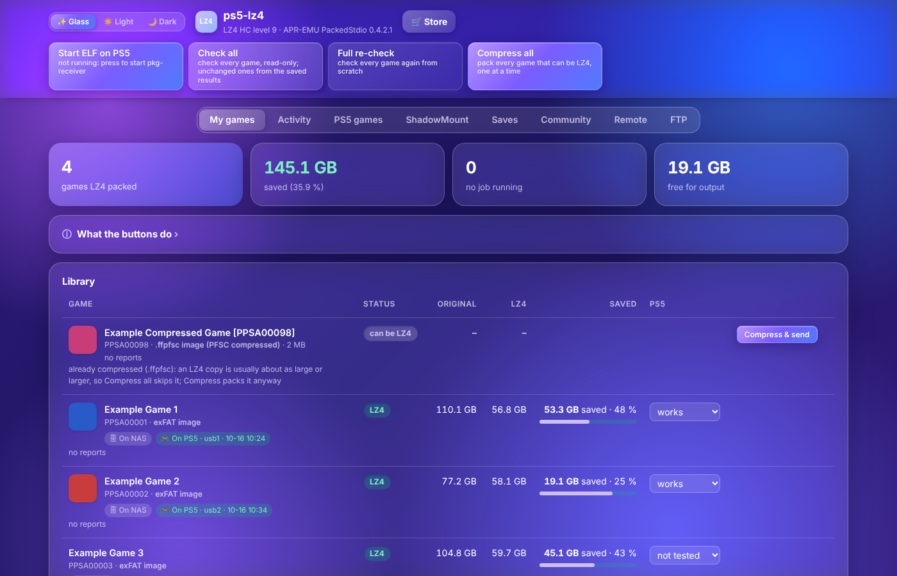

# ps5-lz4: LZ4 HC packing of PS5 games on a NAS

All extraction, LZ4 compression, verification and file handling happen in
Docker containers on the NAS. Nothing runs on the PS5 except the game.

- **Real LZ4 HC**, level 9 by default, with the original project's packer
  (`ampr_pack_cli`, the same C code as the PS5 app). No zlib/PFSC.
- **APR-EMU PackedStdio runtime** 0.4.2.1 (SHA-256 `69e6c4d5…`) goes into
  `fakelib/libSceAmpr.sprx`. It is the only APR-EMU build that reads LZ4 packs.
- **Originals are never touched:** the library is mounted read-only (`:ro`),
  and the tool only deletes inside its own work folder.
- **The packing container has no network** (`network_mode: none`) and changes
  no other containers or NAS settings.



## Install

As root on the NAS (`sudo -i`):

```sh
mkdir -p /volume2/docker/ps5-lz4 && cd /volume2/docker/ps5-lz4
curl -fL https://github.com/dviree/PS5-LZ4-NAS/archive/refs/heads/main.tar.gz -o src.tar.gz \
  && tar xzf src.tar.gz && mv PS5-LZ4-NAS-main src && rm src.tar.gz

# 1. Check only: architecture, Docker, folders, free space, existing files
#    and containers. Changes nothing.
bash src/nas-lz4/install.sh --check

# 2. Install
nohup bash src/nas-lz4/install.sh > install.log 2>&1
tail -20 install.log
```

The install:

- writes `docker-compose.yml`, `.env`, `lz4-ps5.sh`, `logs/`, `reports/` and
  `state/` into `/volume2/docker/ps5-lz4/`;
- pulls the image `ghcr.io/dviree/ps5-lz4:latest` (or builds it on the NAS
  when it can't be pulled; log: `logs/build.log`);
- starts the containers `ps5-lz4` (packing, no network) and `ps5-lz4-ui`
  (web page);
- runs a self-check (`doctor`), lists the library and prints the web page
  address.

Files from an earlier script (`Dockerfile`, `lz4-ps5.sh` and others) are
backed up to `backup-<time>/` before anything is replaced. An old
`/volume1/games/ps5-lz4/.work/` is left alone; the tool uses `.ps5lz4-work/`.

Defaults can be changed with environment variables, for example
`NAS_USER=me LIBRARY=/volume1/games/roms/ps5 OUTPUT=/volume1/games/ps5-lz4 UI_PORT=5921 bash src/nas-lz4/install.sh`.

## Updates and Watchtower

GitHub builds `ghcr.io/dviree/ps5-lz4:latest` after every change, including
each sync from the original project. Watchtower keeps it up to date. If the
image can't be pulled it is built on the NAS instead, and Watchtower leaves
that container alone.

- With `WATCHTOWER_LIFECYCLE_HOOKS=true` on the Watchtower container,
  Watchtower waits until no game is being packed.
- When the container restarts, an unfinished queue continues after the last
  finished step.
- `./lz4-ps5.sh update` pulls the newest image right away (it refuses while a
  game is packed).

## Web page

`http://<NAS IP>:5921`

- **Library:** every game with its source type (game folder, exFAT image,
  `.ffpfsc`, `.ffpfs`) and size, LZ4 status (LZ4 / can be LZ4 / not LZ4 with
  the reason), original and LZ4 size with the saving, your PS5 result and the
  community reports. Games that exist only in the LZ4 folder are listed too.
- **Where each game is:** the LZ4 folder on the NAS and, once sent, the
  folder on the PS5, under the game's name.
- **Click a game** for details (sizes, LZ4 folder, compression, checks, last
  error, community reports, the APR-EMU build in it) and the buttons
  **Compress**, **Send to PS5**, **Open on PS5** (the FTP tab at the game),
  **Check APR-EMU on PS5** (is the copy on the console the PackedStdio
  build?) and the PS5 result.
- **Check all:** read-only check of every LZ4 game (format, APR-EMU, files
  the PS5 reads from disk) and of what can still become LZ4. Results are kept
  in a small database (`state/ps5lz4.db`) keyed by each game's file sizes and
  dates, so games unchanged since their last check are not read again; only
  new or changed games are. When something is wrong, the result has a
  **Repair** button.
- **Full re-check:** the same, but checks every game again, ignoring the
  database.
- **Compress all:** compresses every game that can be LZ4, one at a time,
  except `.ffpfsc` images: they are already compressed, so an LZ4 copy is
  usually as large or larger (Compress on one game packs it anyway; a game
  whose LZ4 copy is larger than its image is marked in the list).
- **Running job:** the six steps with live progress and a stop button (the
  job can be resumed).
- **Activity tab:** everything that runs or waits: the packing job with its
  steps and the packing queue, the transfer to the PS5 with speed and time
  left, the transfer queue (move up, remove, start), failed jobs and recent
  actions. My games shows a one-line summary while something runs.
- **Community tab** (latest report first; or most reports, or name): every game reported by other players, fetched live from
  the GitHub reports every 5 minutes (or **Refresh now**), with search,
  filters and sorting.
- **PS5 games tab:** every game folder on the PS5 (`homebrew` and
  `etaHEN/games` on the internal SSD, USB and extended storage) with its
  icon, name, Title ID, version, drive, LZ4 or not, size (Measure), and a
  warning when two folders have the same Title ID (ShadowMountPlus mounts
  one). Buttons: Delete (one OK), Open in the FTP tab, APR-EMU check.
  It also lists the **PS4 games installed** on the PS5 (`/user/app/CUSA…`,
  and on extended storage) with icon, name and version from their appmeta
  `param.sfo`, the size of `app.pkg` and of an installed patch; a filter
  picks PS5, PS4 or both. Those are uninstalled on the PS5 itself, not here.
  **⚠ Needs attention** (idea from game-library-manager-ps5) lists what
  ShadowMountPlus won't pick up: a hidden name (leading dot), a game one
  folder too deep inside a wrapper folder, a folder without
  `sce_sys/param.json`, an archive still to unpack, and two copies with one
  Title ID. **Fix** renames over FTP: drops the dot, or moves the game
  folder up and removes the emptied wrapper.
  **Verify** on a game compares it with its copy on the NAS (the LZ4 copy
  of the same name, or the library folder): every file there with the same
  size, and the program files (eboot, PRX, ELF) byte for byte with SHA-256;
  it lists what is missing or different. Sending the game again sends just
  those. Large files (256 MB and up) get **spot checks**: four 1 MiB pieces
  (start, end, two random) are read back and compared, during every
  transfer and in Verify. A piece that differs sends that file again. It
  reads back only 4 MiB per file, so the PS5's drive isn't read through.
  **Delete** also takes the game's tile off the PS5 home screen (pkg-receiver
  Glass build 6: `sceAppInstUtilAppUnInstall`), unless another copy with that
  Title ID is still in a game folder; installed PS4 games get **Uninstall**.
- **PS5 packages (`.pkg` with the `\x7fFIH` header)** in the package
  folders are read too (embedded CNT, `param.json`: name, Title ID,
  version, game / patch / DLC / app), next to PS4 packages; a package
  without `icon0.png` uses its first icon variant (0x1201–0x1220). Layout
  and rules follow
  [pkg-sender-synology](https://github.com/mrggbond/pkg-sender-synology)
  (MIT).
- **ShadowMount tab:** the games ShadowMountPlus (1.7+) has on the home
  screen, from its own API (127.0.0.1:10101 on the PS5) through
  pkg-receiver's Glass build 7 (`/api/smp`, a fixed set of routes; nothing
  that moves or deletes a source): icon, name, version, source, mounted.
  **Remove from home screen** uninstalls the tile and leaves the files (the
  next scan finds the game again); **Hide** also renames the source with a
  leading dot, so scans skip it until it is renamed back; **🗑 Delete**
  unmounts it, takes the tile off and deletes its files over FTP (a copy on
  the NAS stays); **Unmount**; **Rescan**. Delete on the PS5 games tab also
  uses it to take a tile off. A name that is only a Title ID is replaced by
  the game's name from the NAS library, the PS5 list or the folder name.
- **🔍 Verify LZ4 (game sheet):** checks a finished LZ4 copy before you send
  it: every LZ4 block decoded and its CRC checked, the file list, and the
  APR-EMU runtime; read-only, in the background. The button turns green
  (verified ✓) or red (failed ✗); the result is under Checks.
- **Duplicates on the NAS (My games):** a Title ID in the library more than
  once (other versions, or a folder and an image) is listed with each copy's
  version and size; the newest is marked, the others can be deleted (needs
  `DELETE_ORIGINALS=yes`; a copy of unknown version is never called older).
- **Move between PS5 drives (ShadowMount tab):** **Move…** lists the drives
  ShadowMountPlus can put a game on, with free space, and starts its own
  move job (copied, checked, old copy removed), with progress, speed and
  Cancel while that is still possible (receiver Glass build 9).
- **RAR archives (Activity tab):** a game in the library packed as RAR
  parts (`name.part1.rar`, … or `name.rar` + `name.r00`, …) gets
  **📦 Extract to exFAT**: unrar extracts it (checking every file's CRC)
  into a hidden temp folder in `<library>/_extracted`, the game folder in it
  is packed into `<name> [TITLEID].exfat` there and every file is compared
  byte for byte, then the temp folder is removed. The image shows up in the
  library like any other game. Only `_extracted` is mounted writable; the
  RAR files stay unless you press **🗑 Delete RAR files**, which needs
  `DELETE_ORIGINALS=yes` and a finished image, and first checks again, right
  before deleting, that every file in the archive is in the image with the
  same size and CRC32 (from the archive's own list; files without a CRC32
  are compared byte for byte through unrar). One mismatch, or a file of the
  archive outside the game that isn't in the image, and nothing is deleted. A failed extract
  keeps its temp folder for a look. Needs about twice the game's size free
  for a while. An archive holding an image (`.exfat`, `.ffpfs`, `.ffpfsc`)
  or a `.pkg` instead of a game folder gets that file moved into
  `_extracted` as it is (deleting the RAR files then checks its CRC32
  against the archive). The install script creates and mounts
  `_extracted`, so run it again once.
- **PS5 Upload tab:** [ps5upload](https://github.com/phantomptr/ps5upload)
  (GPL-3.0, phantomptr): its own engine and web UI (port 19113) in its own
  container. The tab shows whether it runs and opens it in its own browser
  tab (embedded in this page, Safari drops its storage and it forgets the PS5). Install it together with this
  tool with `PS5UPLOAD=yes PS5_IP=<PS5 address>` (image
  `ghcr.io/phantomptr/ps5upload-engine-webui`, host network, the libraries
  read-only as `/games`, `/pkgs`, `/lz4`; `PS5UPLOAD_ALLOW_IP` defaults to
  the NAS's /24, it has no password). An existing `ps5upload` container is
  left alone and opened as it is; another address can be set in the tab.
- **Saves tab** (idea from P5 Manager): **Back up all saves now** copies
  every save folder on the PS5 (`/user/home/<user>/savedata_prospero` for
  PS5 games and `savedata` for PS4 games) to `state/saves/<date>/` over FTP,
  only reading on the PS5, with each file's size checked. Backups are kept
  by date, can be downloaded as a .zip, and **Restore** writes one game's
  saves back to the same user (close the game first; saves are tied to the
  user and console).
- **FPKGi feed:** the package library as FPKGi lists on the catalog port:
  `http://<NAS>:9898/fpkgi/GAMES.json`, `UPDATES.json` and `DLC.json`
  (name, size, region, version, cover; download links on the same port), for
  the FPKGi store app on the console.
- **ShadowMount logs:** **ShadowMount log** and **Kernel log** on the
  ShadowMount tab read SMP's logs (receiver Glass build 8) and mark the
  lines with errors.
- **Metrics:** `http://<NAS>:5921/metrics` in Prometheus format (LZ4 games,
  bytes saved, packing, transfers, PS5 downloads and their speed, save
  backups) for Grafana or Home Assistant.
- **Notifications on the PS5:** "NAS: installing …", "NAS: sending …",
  "… is on the PS5 and checked" or "… stopped" pop up on the console
  (pkg-receiver Glass build 7, `/api/notify`).
- **Nothing is dropped in a transfer:** each file's size is checked after
  its upload, program files byte for byte (SHA-256), large files with spot
  checks, and at the end a fresh listing must show every file of the game
  with its size, else the transfer stops as failed and Send fills in what
  is missing.
- **Notifications (Remote tab):** an [ntfy](https://ntfy.sh) topic URL or
  any webhook (JSON `title`, `message`, `ok`; e.g. Home Assistant) gets a
  push when packing, a check, a transfer to the PS5 or a download by the
  PS5 finishes or fails. **Send a test** tries it. Also settable with
  `PS5LZ4_NOTIFY_URL`.
- **Downloads to the PS5 (Activity tab):** every package or image the PS5
  downloads from this NAS (installs from this page or from *pkg remote
  installer*), counted by the byte ranges sent: progress, speed, time left,
  and the recent downloads and install requests (`state/pkg_history.json`)
  with **Retry** for a failed install.
- **Game sheet (tap a game):** where the original is on the NAS, every copy
  of the game on the PS5 (found by Title ID, however it got there), and the
  buttons **⚡ Compress & send to PS5** (packs it and sends it, or queues it,
  as soon as it is packed and checked; the library list has the same
  **Compress & send** button), **Compress only**, **Check APR-EMU on PS5**
  (the answer shows right under the buttons), **Send original to PS5** (the folder or image as it is, for games
  that aren't LZ4), **🗑 Delete from PS5** and **🗑 Delete LZ4 copy on NAS**
  (frees the space; the original is never touched).
- **Remote tab:** the PS5 address, pairing and wake-up (see below), and the
  PS5's drives (internal SSD, USB, extended storage) with what ps5-lz4 sent
  there, how many game folders they hold, **Measure** (adds up the files)
  and **Set size** (ftpsrv can't report a drive's size or free space: enter
  it once and the page shows free = size − measured, with a bar).
- **FTP tab:** browse the PS5's drives over ftpsrv, game folders with their
  icon (`sce_sys/icon0.png`, cached in `state/icons/`) (`/data`, `/mnt/usb0`,
  `/mnt/ext0`, ...) download files as they are on disk (SELF decryption off)
  or whole folders as ZIP, upload files and folders from your phone or
  computer, make folders, and delete files or folders (only inside `/data`, `/mnt/usbN` and
  `/mnt/extN`, at least two folders down; also while a transfer runs, and
  deleting the game being sent stops that transfer first).
- **Send to the PS5**, **wake** and **pair**: see below.

The page runs in its own container (`ps5-lz4-ui`). It sees the library and
the LZ4 games read-only, has no Docker socket and never runs packing jobs: it
leaves a request that `ps5-lz4` (no network) carries out. Transfers to the
PS5 run in `ps5-lz4-ui` because they need the network. The page has no
login, so only reach it from your home network (or over a VPN such as
Tailscale), never through a router port forward.

## Send to the PS5

On the **Remote** tab set the PS5's FTP address (ftpsrv, for example
`192.168.1.20:2121`) and the destination (for example `/mnt/usb0/homebrew`).
**Send to PS5** on a game then:

- copies the LZ4 folder straight to ftpsrv (not through an rclone mount);
- turns off ftpsrv's SELF decryption, which would otherwise report other
  sizes for program files;
- refuses if the destination already holds another copy of the same title ID
  (ShadowMountPlus mounts one copy per title);
- checks the size of every file and compares the program files (`eboot.bin`,
  `.prx`, `.sprx`) by SHA-256, uploading one again if it differs;
- resumes an interrupted transfer by skipping finished files and continuing
  a half-sent file where it stopped (ftpsrv supports REST);
- wakes the PS5 again if it goes to rest mode during the transfer, and
  carries on (to keep it awake: Settings › System › Power Saving › Set Time
  Until PS5 Enters Rest Mode › Don't Put in Rest Mode);
- queues games sent while another transfer runs and sends them in turn. The
  queue starts by itself whenever nothing is being sent: after a game is
  done, after **Stop** (which stops only that game) and after a restart;
- adds a PlayGo emulator to the PS5 copy's `fakelib/` when the game needs
  one and the LZ4 folder has none (see *Boot files* below). It is taken from
  the NAS or downloaded from the console (`/data/shadowmount/emus`, other
  games' `fakelib/`, ...) and kept in `state/playgo/` for next time.

### Wake from rest mode and pair (like Chiaki)

If the PS5 doesn't answer, the transfer wakes it first with the Remote Play
wake-up Chiaki uses, waits for ftpsrv and then copies. That needs the
registration key, which you get by **pairing**:

1. On the **Remote** tab, enter the PSN account ID of the account signed in on
   the PS5, in the base64 form Chiaki uses (12 characters ending in `=`).
   Already set up in Chiaki? Use the same ID. A normal PSN account: chiaki-ng
   can look it up when you sign in with PSN. A fake signed-in (offline
   activated) account: the ID the activation tool gave it. A decimal or
   `0x` hex number works too; the page shows how it reads what you typed.
2. On the PS5: Settings › System › Remote Play › Pair Device. An 8-digit PIN
   is shown for a few minutes.
3. Enter the PIN and press **Pair** while it is still on screen.

If you have already paired in Chiaki, you can enter its `rp_regist_key`
(up to 8 hex characters) instead. The keys are stored in
`state/settings.json` (readable by the owner only) and never sent back to the
page. The pairing code is a port of chiaki-ng's registration
(`ps5regist.py`, AGPL-3.0).

**Wake PS5 now** says what happened: on, or why not. If the PS5 answers in
rest mode but doesn't turn on, the key wasn't accepted: pair again. If it
doesn't answer at all, turn on *Stay Connected to the Internet* and *Enable
Turning On PS5 from Network* under Settings › System › Power Saving ›
Features Available in Rest Mode.

## Store (for the PS5 browser)

`http://<NAS IP>:5921/store` is the library as a store, made for a TV and a
controller: covers, size, LZ4 or original, community stars, and whether each
game is on the PS5. **Install** sends it (queued behind other installs, with
speed and time left), **Uninstall** deletes it from the PS5, **Pause** and
**Resume install** continue where it stopped.

Ideas from Overdrive (no catalog, only your own library): **★ Favorites**
(press ☆ on a game; kept in that browser) with their own filter, sorting
(A–Z, newest packed, best rated by the community, biggest, smallest, most
saved; remembered), and **spotlight rows** on top: newest packed and best
rated.

## The ELF on the PS5: pkg-receiver

The PS5 side is **pkg-receiver** from
[Loopayeh/pkg-sender](https://github.com/Loopayeh/pkg-sender) (MIT). The
header's **Install ELF on PS5** (and the Remote tab's **ELF on the PS5**
card) downloads `pkg-receiver.elf`, copies it to
`/data/pldmgr/payloads/pkg-receiver/pkg-receiver.elf` and starts it. It
installs packages from this NAS, its own page on the PS5 lists this NAS's
packages (see *Picking packages on the PS5*), and it reports the internal
SSD's free space.

Installing is needed once (and for a new version). After a PS5 restart the
header's **Start ELF on PS5** (or **Start** on the card) starts the copy
already in Payload Manager, without downloading it again; with **Start by
itself when the PS5 is on** (on by default, `state/engine/receiver-auto.json`)
this page does that on its own: every 30 seconds it checks whether the PS5
is on and pkg-receiver answers, and starts it if not (at most every 5
minutes). That needs Payload Manager (or an ELF loader) running on the PS5.

The ELF it installs is pkg-sender's own source with this page's **Glass
theme** on the *pkg remote installer* page: purple gradient, frosted cards
and gradient buttons (`pkg-receiver/glass.py` adds `pkg-receiver/glass.css`
to `payload/main.c`; nothing else changes). The *Build pkg-receiver
(Glass)* workflow builds it from a pinned pkg-sender commit and publishes
the `pkg-receiver-glass` release. Without that release, or with
`PS5LZ4_RECV_GLASS=` (empty), pkg-sender's own build is used. Installing
again replaces a running receiver of another build; there's no need to
restart the PS5.

The Glass build also **keeps the PS5 awake**: while it runs it resets the
PS5's auto power-down timer every 20 seconds (the same calls the LZ4
engine's power guard makes), so the PS5 does not go to rest mode. The
**Stay awake** switch in its page header turns that off (remembered in
`/data/pkg-receiver-awake-off`); it then stays awake only while it installs
or copies, or while this page transfers to it (`/api/keep-awake?seconds=N`).

The LZ4 Compression engine is no longer installed or updated from this
page (`PS5LZ4_ENGINE_CHECK` is `0`), and rest mode after transfers is off,
because both need that engine. If it runs on the PS5 anyway, transfers
still ask it to keep the PS5 awake. The sections below describe it for
that case.

## Keeping the PS5 awake during transfers

While a game is sent, the NAS asks the LZ4 Compression engine on the PS5
(port 5920, when it runs) to hold off rest mode (`/api/lzc/keep-awake`,
renewed every minute, released at the end). That endpoint is in this fork's
engine (`lz4-compression.elf` built from this repository); the original
engine ignores it, and then the PS5 is woken again if it goes to rest mode.

**Connecting the two:** the Remote tab's *LZ4 Compression engine on the PS5*
card shows whether the engine answers (connected / original build / not
running) and can:

- **Install this build on the PS5**: downloads `lz4-compression.elf` from the
  newest release of this repository (checked against `SHA256SUMS`, cached in
  `state/engine`) and copies it over FTP to
  `/data/pldmgr/payloads/lz4-compression/lz4-compression.elf`, where the
  Payload Manager loads it, overwriting the file that was there.
- **Start it now**: asks Payload Manager (port 8084) to load the installed
  engine; the new engine takes over from one that already runs (the engine's
  handoff), so no restart is needed. Without Payload Manager answering, and
  with no engine running, the ELF is sent to an ELF loader (port 9021, then
  9020). The card shows the version and process of the engine that runs.
- The install also writes `/data/LZ4Compression/update-feed` with this
  repository's release feed. The LZ4 Compression app updates the engine from
  that feed (its `update.js`), so it no longer puts the original engine back.
- **Restore the original**: shown only when an earlier version left a
  `lz4-compression.elf.orig` on the PS5; puts that file back.

The header has the same install as one button, **Install ELF on PS5**
(install, then start it if no engine runs yet).

**Reading and updating it:** *Read the ELF on the PS5* fetches the file over
FTP and compares its SHA-256 with every release of this repository, so the
card says which release is on the PS5, whether it is the newest, or that it
isn't one of these releases (the original engine). When a newer release is
out, the header button turns green and blinks: **Update available**. With
*Update it automatically* on (the default), the web page container reads the
ELF every 6 hours (`PS5LZ4_ENGINE_CHECK`, seconds; `0` turns it off) and
overwrites an older release of this repository with the newest one over FTP.
An engine that isn't from this repository is never replaced by itself. A
running engine keeps going; the new file runs from the next start.

Updates come from this repository (`dviree/PS5-LZ4-NAS`);
`PS5LZ4_ENGINE_REPO` picks another one.

**The app on the PS5:** the same card has **Install app on PS5**. It
downloads `LZ4-Compression-PPSA99420.zip` from the original project's latest
release (SHA-256 checked, `PS5LZ4_APP_REPO` picks another repository) and
copies its `PPSA99420` folder over FTP to `/data/homebrew/PPSA99420`.
ShadowMount+ then adds the LZ4 Compression tile: the console UI made for the
controller, which uses the engine on the PS5.

## .ffpfsc compatibility list

The web page container fetches the community's .ffpfsc compatibility sheet
(a Google Sheet, as CSV) every 6 hours and keeps it in
`state/ffpfsc_sheet.json`. A game's sheet shows its row under the sheet's own
column names, found by title ID in any column, else by name, with **Open the
sheet** next to it. `PS5LZ4_FFPFSC_SHEET` is the CSV export URL (empty turns
it off).

## Compress on the PS5

On the **PS5 games** tab, an unpacked PS5 game (PPSA…, not LZ4, no warnings) has
**⚡ Compress on PS5**. The NAS starts the LZ4 Compression engine on the console
(Payload Manager or the ELF loader, next to pkg-receiver) and asks it to `lz4-pack`
the game there at level 9. The original is kept (`deletePolicy=keep`); the packed
copy lands next to it. A banner shows progress and has **Cancel**. Nothing is copied
over the network. Check the result with Verify, then test it on the PS5.

## exFAT images of LZ4 games

Some games only start when they run from an image instead of a folder. In
a packed game's sheet:

- **Make exFAT image** packs the LZ4 folder into one file,
  `<name>-lz4.exfat`, next to it in the output folder (MkPFS), then compares
  every file in the image with the LZ4 folder byte for byte. Only then is the
  image kept; the LZ4 folder stays. Progress and **Stop** are on the Activity
  tab.
- **Send exFAT image to PS5** sends that file to the PS5 folder (resumable,
  like every transfer). ShadowMount+ mounts it from there. The PS5 must not
  hold the same game as a folder too (one copy per title).
- **Compress, make exFAT and send to PS5** (and **Make exFAT and send to
  PS5** for packed games) does it all in one go: LZ4, image, check, send.
- **Delete exFAT image** removes the image; the LZ4 folder stays.

Making an exFAT image of the original first changes nothing: the NAS unpacks
it again before LZ4 packing. Originals are never converted.

## PS4 packages (.pkg)

PS4 games can't be LZ4 (APR-EMU is PS5 only), but their `.pkg` files can be
sent to the PS5 and installed there. The install script mounts
`PS4_LIBRARY` (default `/volume1/games/roms/ps4`, read-only) into the web
page container; `.pkg` files in the PS5 library are listed too.

The **Packages** card on My games lists each package with its name, CUSA
ID, version, type (Game, Update, DLC) and icon, read from the package itself.

- **⬇ Install on PS5**: the PS5 downloads the package straight from this page
  (`/pkgfile/...`, with Range requests) and installs it with its own
  installer. That needs **pkg-receiver** on the PS5
  ([Loopayeh/pkg-sender](https://github.com/Loopayeh/pkg-sender), MIT, port
  12800): the Remote tab's **Install and start** downloads
  `pkg-receiver.elf`, copies it to
  `/data/pldmgr/payloads/pkg-receiver/pkg-receiver.elf` and starts it through
  Payload Manager (or an ELF loader). The same card shows the internal SSD's
  free space, which pkg-receiver reports.
- **⬆️ Copy to /mnt/usb0** copies the file to the PS5's package folder (set
  on the Remote tab), resumable like every transfer; **Install from
  /mnt/usb0** then installs that copy, or use ItemzFlow / etaHEN.

The PS5 reaches the page at the address the browser used (the request's
host); set `PS5LZ4_NAS_URL` (e.g. `http://192.168.1.10:5921`) if that isn't
an address the PS5 can reach.

## Picking packages on the PS5, finding the PS5, free space

- **pkg-receiver's own page on the PS5** (its *pkg remote installer*
  home-screen shortcut, or `http://<PS5>:12800`) shows this NAS's packages
  in its Games tab: the web page container serves the same catalog as
  pkg-sender on port 9898 (`/catalog`, `/pkg/<id>`, `/icon/<id>`;
  `CATALOG_PORT` in the install script) and tells the PS5 where it is with
  pkg-sender's UDP message to port 12802 every 3 seconds. Pick a game with
  the controller and install it. Its **Images** tab lists the library's
  `.exfat` / `.ffpfsc` / `.ffpfs` images and the LZ4 copies' `.exfat`
  images, with covers and titles read from the game's own
  `sce_sys/icon0.png` and `param.json` (inside `.exfat` images, inside the
  exFAT image wrapped by a single-file `.ffpfsc` / `.ffpfs`, nothing is
  unpacked; or from the LZ4 copy). The library and Store use the same
  covers. A game with more than one image (the original and its LZ4 copy's
  `.exfat` image) gets one card with **exFAT | LZ4** to pick which one;
  The page also shows what is already on the PS5: **✓ Installed** (with the
  installed version) on games and patches, **✓ On PS5** on images in a
  homebrew folder (and LZ4 copies sent there), **Partly copied** on a short
  copy. **Copy to homebrew** pulls one from the NAS into
  `/data/homebrew`. If pkg-sender also runs on a PC, the page follows
  whichever announced itself last: close it there, or type the NAS address
  in the page.
- **🔍 Find PS5** (Remote tab, next to the address) sends the PS5's own
  discovery message to every address of the local /24 and lists each PS5
  that answers, on or in rest mode, with its name; **Use this one** saves
  it. Handy when the router gave the PS5 a new address.
- **PS5 storage** shows each drive's real size and free space from the LZ4
  Compression engine (`/api/lzc/df`, engine v1.5.0-nas.3 or newer), or the
  internal SSD's from pkg-receiver; the manual size is only needed without
  them.

## Rest mode when everything is sent

When this page wakes the PS5 to send games (Remote Play wake-up), it puts it
back in rest mode once nothing is being sent, nothing waits to be sent after
packing, and three minutes have passed (`PS5LZ4_REST_IDLE`, seconds). A PS5
that was already on is left alone, so nobody is cut off mid-game. It goes
through the engine's `/api/lzc/rest` (engine v1.5.0-nas.2 or newer); the
engine refuses while it runs a job of its own. Turn it off with **Rest mode
when everything is sent** on the Remote tab; **Rest mode now** does it at once.

## Deleting originals

By default the library is mounted read-only, so nothing can change or delete
an original game. To be able to delete originals from the web page (the
**🗑 Delete original on NAS** button in a game's sheet), reinstall with
`DELETE_ORIGINALS=yes`:

```sh
cd /volume2/docker/ps5-lz4
rm -rf src && curl -fL https://github.com/dviree/PS5-LZ4-NAS/archive/refs/heads/main.tar.gz | tar xz && mv PS5-LZ4-NAS-main src
DELETE_ORIGINALS=yes bash src/nas-lz4/install.sh
```

Then only the packing container (`ps5-lz4`) gets the library writable; the
web page container still sees it read-only, and packing never writes to it.
Each delete asks first and says whether an LZ4 copy remains. Reinstall
without the variable to turn it off again.

**Test first, delete later.** An original that has an LZ4 copy is only
deleted once that game's **PS5 result** says *works* (or *works with issues*),
and the RAR files of an extracted game only once the extracted `.exfat` is
marked so. Set the PS5 result in My games (every game has it, not only LZ4
ones; results of games that are not LZ4 stay on the NAS in `state/played`).
Verified on the NAS is not the same as playable on the PS5.

## Commands

Run from `/volume2/docker/ps5-lz4/` with `sudo` (Docker needs root). Jobs run
inside the container as your NAS user, so the files belong to that user.

| Command | What it does |
| --- | --- |
| `./lz4-ps5.sh lz4` | One line per game: `LZ4` (done, format checked), `kan bli LZ4` (can be LZ4), `inte LZ4` (not LZ4, with the reason) or `FEL` (error) |
| `./lz4-ps5.sh lz4 --fix` | Packs every game that can be LZ4, in the background |
| `./lz4-ps5.sh apr` / `apr --fix` / `apr --full` | Checks / repairs every LZ4 game: pinned APR-EMU and the files the PS5 reads from disk. Unchanged games reuse their last result; `--full` checks all again |
| `./lz4-ps5.sh community` | How the games run for others (reports from the original project) and your own PS5 result |
| `./lz4-ps5.sh community <game> works` | Saves your result (`works`, `issues`, `nostart`, `crash`) and prints a prefilled link to share it |
| `./lz4-ps5.sh scan --check` | Lists the library with numbers, status and LZ4 compatibility (reads `eboot.bin` straight from `.exfat` images) |
| `./lz4-ps5.sh start 3` | Starts game 3 in the background. Several games make a queue: `start 3 5 "My game.exfat" PPSA12345` |
| `./lz4-ps5.sh start --all` | Every game that isn't done |
| `./lz4-ps5.sh run 3` | Like `start`, in the foreground |
| `./lz4-ps5.sh status` | Running job, step and progress, queue and errors |
| `./lz4-ps5.sh stop` | Stops the job; the work is kept |
| `./lz4-ps5.sh start --resume` | Continues a stopped or interrupted queue after the last finished step |
| `./lz4-ps5.sh report` | Original size, LZ4 size and saving per game and in total |
| `./lz4-ps5.sh verify "My game-lz4"` | Verifies a finished result again (every block decoded, CRC) |
| `./lz4-ps5.sh clean <name>` | Removes the work folder of a failed game |
| `./lz4-ps5.sh update [--force]` | Pulls the newest image and restarts the containers now |
| `./lz4-ps5.sh push <game>` | Sends a finished LZ4 game to the PS5 over FTP and checks it |
| `docker exec -u <PUID> ps5-lz4-ui ps5lz4 wake` | Wakes the PS5 from rest mode |
| `docker exec -u <PUID> ps5-lz4-ui ps5lz4 pair <PIN> <account ID>` | Pairs with the PS5 for Remote Play wake-up |
| `./lz4-ps5.sh doctor` | Self-check |

Options for `start`/`run`: `--level N` (1–4 LZ4 fast, 5–12 LZ4 HC, default
9), `--require-vhash` (skip `.ffpfsc` images without a `.vhash`) and
`--force-image` (pack an image even when the same game exists as a folder).

**Try one game first:** `scan --check`, then `start <#>` for a compatible
game, then `status` and `report`. Test it on the PS5 before `start --all`.

## What happens to each game

1. **Source**
   - **Game folder:** used as it is (read-only), no extraction.
   - **`.exfat`:** extracted with MkPFS 1.1.0's exFAT reader (no mount, no
     privileged container). Every file is checked against the image's
     directory: present and the right size.
   - **`.ffpfs` / `.ffpfsc`:** the outer PFS image is unpacked, then the
     inner one (`pfs_image.dat` or `.exfat`). If `<image>.vhash` exists
     (written by the PS5 app or Game Compressor), every 64 KiB block of the
     inner image is checked against its SHA-256; a mismatch stops the job.
   - When the same game (title ID) exists as a folder and as an image, the
     folder is used and the image skipped.
2. **Compatibility** (the PS5 app's rule): a program file must import
   `libSceAmpr`, or the game already ships APR-EMU in `fakelib/`. Otherwise
   it is skipped. Already packed games and games LZ4 can't shrink are
   skipped too.
3. **Packing:** LZ4 HC on all cores but one, at lower priority (`nice` /
   `ionice`) so other services keep running. The profile is chosen
   automatically: your own TOML in `state/profiles/<TITLEID>.toml`, else a
   bundled one (ASTRO BOT, UFC 6, Insomniac, Unity), else the scan-based
   one. The packer compares every packed file byte for byte with the source.
4. **Verification:**
   - `ampr_pack_cli verify` checks the manifest and CRC, decodes every chunk
     and compares it byte for byte with the source again.
   - The format is checked: `AMPRPAK4` index, `AMPRDAT3` volumes, sidecars,
     and that the runtime is exactly the pinned PackedStdio build.
5. **Restore test:** everything is unpacked to a temporary folder and every
   file compared byte for byte with the source. Only `ampr_emu.index` and
   `fakelib/libSceAmpr.sprx` may differ (they are added or replaced on
   purpose). It has two parts, and the web page shows progress, data left
   and time left for each: *unpacking* (writes the whole game once) and
   *comparing with the original* (reads every file twice, about as long
   again). For a 180 GB game on hard disks, plan for one to two hours.

While a game is packed, the Activity tab, the summary card and the bubble in
the corner show the speed, the time left for the step and for the whole game.
The page server works them out from the progress (no need to keep the page
open first); the steps still to come use the speed earlier games had
(`state/rates.json`), so the whole-game time shows from the second game on.
6. **Boot files** (at the start of Publish; the original project's Verify check): some games
   stop with SIGBUS a few seconds after starting (HITMAN 3, 007 First Light).
   - The folder named by `RUNTIME_PATH=` in `eboot.bin` exists only in
     another case (`Runtime/` for `runtime/`); the PS5 is case-sensitive, so
     it is renamed.
   - The game imports `libScePlayGo` and `fakelib/` has no PlayGo library: a
     PlayGo emulator is copied in. It isn't shipped; it is taken from
     `state/playgo/libScePlayGo.sprx` (put one there yourself, or let
     **Send to PS5** fetch it from the console) or another game's
     `fakelib/`.
   - A plain ELF `eboot.bin` is noted (it may need FSELF).
   **Check all** reports these for games packed earlier, and **Repair** fixes
   them.
7. **Publish:** the result moves to `/volume1/games/ps5-lz4/<name>-lz4/`, the
   report is written to `reports/<name>.json` and `summary.tsv`, and the work
   folder is deleted. A short log per game stays in `logs/<name>.log`.

If a step fails the work folder stays in
`/volume1/games/ps5-lz4/.ps5lz4-work/<name>/` for troubleshooting (`status`
shows the error). Running the same game again continues after the last
finished step; a step that was interrupted is redone. An existing result is
never overwritten.

Progress from SSH: the job runs as `ps5lz4.py run --from-queue` in the
`ps5-lz4` container. The compare step reads in that process itself (the
packer runs as a separate program), so its `read_bytes` grows by about twice
the game's size during the compare:

```sh
for P in $(docker top ps5-lz4 -eo pid | tail -n +2); do
  echo "$P $(grep read_bytes /proc/$P/io | awk '{printf "%.1f GB", $2/1073741824}') $(tr '\0' ' ' < /proc/$P/cmdline | cut -c1-60)"
done
```

Run it twice a minute apart; the difference is the read speed.

Space: everything large goes to the output volume. Plan for about 3× the
game's unpacked size free during a job (extraction + packs + restore test).
The tool checks before every step and keeps a 20 GB margin
(`PS5LZ4_FREE_MARGIN_GB`).

## Verified on the NAS is not tested on the PS5

`verified_on_nas: true` means the LZ4 packs are correct: every file comes back
byte for byte. It does **not** mean the game was tested on the console. To
play it, it needs:

- **ShadowMountPlus**, which loads `fakelib/libSceAmpr.sprx` instead of the
  system module. Copy the folder to the console (for example `/data/homebrew/`
  or an external drive). Keep one copy per title ID there.
- **The right runtime.** Only APR-EMU PackedStdio 0.4.2.1 reads the packs, and
  it is in the folder. Don't replace it with another APR-EMU version;
  **Check all** / `apr` find it if something did.
- **The right profile.** Results vary per game; a trace-based profile in
  `state/profiles/<TITLEID>.toml` is safer than the automatic one.
- **The original until it has run.** Keep it until the game has started.

Mark the result on the web page and share it with the community.

## Files

```
/volume2/docker/ps5-lz4/
  src/                  source (this repository)
  docker-compose.yml    .env    lz4-ps5.sh
  logs/                 build.log, <game>.log, queue-*.log
  reports/              <game>.json, <game>.skipped.json, summary.tsv
  state/                queue, lock, settings, own profiles (state/profiles/)
/volume1/games/ps5-lz4/
  <game>-lz4/           finished LZ4 games
  .ps5lz4-work/         work folders (empty after successful jobs)
```
